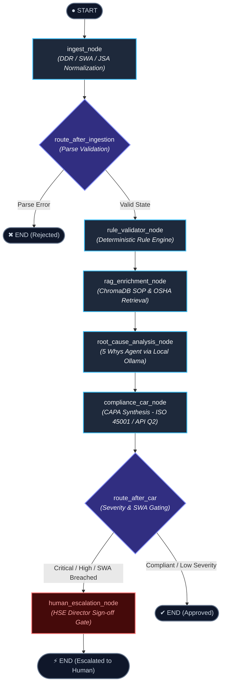

# Safety Graph Orchestrator 🛡️⚡

[](#testing)
[](https://github.com/langchain-ai/langgraph)
[](https://www.trychroma.com/)
[-orange.svg)](https://ollama.ai)
[](#regulatory-frameworks)

An enterprise-grade, stateful multi-agent workflow orchestration system built with **LangGraph (Python)** that automates:
1. **Daily Drilling Report (DDR) Ingestion & Semantic Parsing**
2. **Stop Work Authority (SWA) & Incident Notifications**
3. **Job Safety Analysis (JSA / JHA) Audit Verification**
4. **Deterministic Hard Safety Rule Validation (Zero-Hallucination Gating)**
5. **Vector Retrieval (ChromaDB) over Company SOPs and OSHA/API Standards**
6. **5 Whys Root Cause Analysis (RCA) via Local Ollama Models**
7. **Corrective & Preventive Action Report (CAR / CAPA) Synthesis**
8. **Human-in-the-Loop (HITL) Safety Director Escalation Routing**

---

## Architecture & State Machine

The orchestrator operates as a directed acyclic state graph with conditional branching managed by **LangGraph**. The workflow enforces a **deterministic-first gating pattern**: probabilistic LLMs are never permitted to override hard safety constraints.



---

## Enterprise Design Patterns

### 1. Deterministic-First Safety Gating
Safety-critical systems cannot rely solely on probabilistic generation. The **`SafetyRuleEngine`** deterministically validates hard operational thresholds before and alongside LLM reasoning:
- **H2S Gas Threshold**: Mandates immediate SCBA and evacuation whenever $H_2S \ge 10\text{ ppm}$ (OSHA 1910.120).
- **Well Control Barrier Integrity**: Flags pressure-containing breaches on choke lines operating above $3,000\text{ PSI}$ (API Spec 16D).
- **Stop Work Authority Resumption**: Enforces that operations halted under SWA cannot restart without documented supervisor verification (API RP 54 §4.3).
- **Fall Protection**: Mandates 100% dual lanyard tie-off above 6 feet / derrick monkey board (OSHA 1926.501).

### 2. Stateful Multi-Agent Reducers
The graph state is defined via `SafetyGraphState`, utilizing typed dictionaries and custom operator reducers:
```python
class SafetyGraphState(TypedDict, total=False):
    raw_input: str
    input_type: InputType
    unified_data: Optional[UnifiedSafetyData]
    rule_violations: Annotated[List[RuleViolation], add]
    retrieved_sops: Annotated[List[RetrievedSOP], add]
    rca_result: Optional[RootCauseAnalysisResult]
    car_report: Optional[CorrectiveActionReport]
    escalation_required: bool
    status: AuditStatus
    audit_log: Annotated[List[AuditLogEntry], add]
    errors: Annotated[List[str], add]
```
Appending reducers (`add`) ensure parallel node runs and sub-agent updates accumulate immutable audit telemetry without race overwrites.

### 3. Local LLM Architecture (Ollama + Resilient Heuristic Fallback)
RCA and CAR generation leverage local, cost-effective models (e.g. `llama3.2:latest` or `mistral`) running on an on-premise or edge Ollama daemon:
- **Zero Cloud Exposure**: Sensitive rig operational logs and near-miss telemetry never leave the corporate boundary.
- **Fail-Safe Mock Provider**: An integrated `MockOllamaChatModel` and deterministic heuristic generator guarantees 100% test reliability in air-gapped CI/CD environments.

### 4. ChromaDB RAG with Curated Safety Corpus
An embedded vector store indexes Standard Operating Procedures (SOPs) and CFR regulatory codes:
- `SOP-042`: High-Pressure Choke Manifold Make-up, Bolt Torquing & Testing (API Spec 16D)
- `SOP-108`: Derrick Monkey Board Fall Arrest & Twin-Tail Lanyards (OSHA 1926.501)
- `SOP-215`: Confined Space Entry & Mud Pit Sniff Testing (OSHA 1910.146)
- `SOP-301`: Tripping Pipe Swabbing Prevention & Well Control Trip Sheets (API RP 54)
- `SOP-504`: Stop Work Authority (SWA) Resumption Protocol (ISO 45001)
- `OSHA-1910.120`: Hazardous Waste & Toxic Gas (H2S) Ceiling Limits
- `OSHA-1910.147`: Control of Hazardous Energy (Lockout / Tagout)

---

## Repository Structure

```
safety-graph-orchestrator/
├── pyproject.toml              # Modern UV/PEP 621 configuration
├── README.md                   # Architecture & recruiter documentation
├── src/
│   └── safety_graph_orchestrator/
│       ├── cli.py              # Rich CLI interface (audit, rules, sops, demo)
│       ├── core/
│       │   ├── config.py       # Pydantic BaseSettings & env configs
│       │   ├── models.py       # Domain models (DDR, SWA, JSA, Violations, CAR)
│       │   ├── state.py        # LangGraph State Schema with reducers
│       │   └── llm.py          # ChatOllama factory + deterministic mock provider
│       ├── parsers/
│       │   ├── base.py         # Abstract parser interface
│       │   ├── ddr_parser.py   # Daily Drilling Report JSON & text parser
│       │   ├── swa_parser.py   # Stop Work Authority notification parser
│       │   ├── jsa_parser.py   # Job Safety Analysis matrix auditor
│       │   └── detector.py     # Document type auto-classifier
│       ├── rules/
│       │   ├── base.py         # BaseSafetyRule definition
│       │   ├── engine.py       # Priority-sorted safety rule engine
│       │   └── builtins.py     # Deterministic OSHA / API RP 54 rule implementations
│       ├── retrieval/
│       │   ├── corpus.py       # Seeded company SOPs and OSHA CFR text
│       │   └── vector_store.py # ChromaDB persistent vector collection
│       ├── rca/
│       │   └── five_whys.py    # 5 Whys iterative causal interrogation agent
│       ├── compliance/
│       │   └── car_generator.py# CAR / CAPA generator (ISO 45001 / API Q2)
│       └── graph/
│           ├── builder.py      # LangGraph state graph compiler & runner
│           ├── nodes.py        # Graph execution nodes
│           └── edges.py        # Conditional routing functions
├── data/
│   └── samples/                # Realistic test payloads
│       ├── ddr_deepwater_kick.json & .txt
│       ├── swa_h2s_manifold.json & .txt
│       ├── jsa_tripping_operations.json & .txt
│       └── ddr_routine_compliant.json
└── tests/                      # 32 Comprehensive Unit & Integration Tests
    ├── conftest.py
    ├── test_ddr_parser.py
    ├── test_swa_parser.py
    ├── test_jsa_parser.py
    ├── test_rules_engine.py
    ├── test_retrieval.py
    ├── test_rca_five_whys.py
    ├── test_car_generator.py
    ├── test_graph_transitions.py
    └── test_e2e_workflow.py
```

---

## Getting Started

### Prerequisites
- Python 3.12+ (Python 3.14 compatible)
- [uv](https://github.com/astral-sh/uv) (recommended) or standard `pip`
- Optional: Local [Ollama](https://ollama.ai) daemon running `llama3.2`

### Installation
```bash
git clone https://github.com/your-username/safety-graph-orchestrator.git
cd safety-graph-orchestrator

# Install dependencies in an isolated virtual environment
uv sync
```

---

## CLI Usage & Interactive Demo

The system includes a CLI built with **Typer** and **Rich** formatting:

### 1. Run the Full Incident Simulation (Demo)
```bash
uv run safety-graph-orchestrator demo
```

### 2. Audit Any Operational Report (DDR / SWA / JSA)
```bash
# Audit a deepwater gas kick DDR
uv run safety-graph-orchestrator audit data/samples/ddr_deepwater_kick.json

# Audit an unstructured freeform tour sheet
uv run safety-graph-orchestrator audit data/samples/ddr_deepwater_kick.txt

# Audit a Job Safety Analysis risk matrix
uv run safety-graph-orchestrator audit data/samples/jsa_tripping_operations.json
```

### 3. Inspect Deterministic Safety Rules
```bash
uv run safety-graph-orchestrator rules
```

### 4. Query Company SOPs & OSHA Regulations via Vector RAG
```bash
uv run safety-graph-orchestrator sops "choke manifold leaking flange torque"
```

---

## Sample Execution Output

When auditing `swa_h2s_manifold.json` (leaking choke manifold and premature restart):

```
╭──────────────────── 1. Normalized Operational Ingestion ─────────────────────╮
│ Asset / Rig: NABORS-PACIFIC-09 | Document Type: SWA                          │
│ Operational Summary: SWA Invoked (SWA-2026-0881) on Rig NABORS-PACIFIC-09 at │
│ Choke & Kill Manifold Skid by Lead Motorman. Hazard: Observed continuous     │
│ fluid mist and audible hissing from the 4-inch API Spec 16D choke manifold   │
│ buffer flange operating under 4,800 PSI. Handheld multi-gas meter registered │
│ 16.2 ppm H2S in the immediate breathing zone.                                │
│ Metrics: Pressure: 4800.0 PSI | H2S: 16.2 ppm | SWA: True                    │
╰──────────────────────────────────────────────────────────────────────────────╯
                 2. Deterministic Rule Violations (3 Detected)                  
┏━━━━━━━━━━━━━━━┳━━━━━━━━━━┳━━━━━━━━━━━━━━━━━━━━━━━━━━━━━┳━━━━━━━━━━━━━━━━━━━━━┓
┃ Rule ID       ┃ Severity ┃ Violation & Evidence        ┃ Regulatory Citation ┃
┡━━━━━━━━━━━━━━━╇━━━━━━━━━━╇━━━━━━━━━━━━━━━━━━━━━━━━━━━━━╇━━━━━━━━━━━━━━━━━━━━━┩
│ RULE-H2S-001  │ CRITICAL │ Measured H2S reached 16.2   │ 29 CFR 1910.120 /   │
│               │          │ ppm (Threshold: 10.0 ppm)   │ API RP 54 §20.3     │
│ RULE-SWA-005  │ CRITICAL │ Operations resumed without  │ API RP 54 §4.3 &    │
│               │          │ supervisor sign-off         │ IADC SMS Policy     │
│ RULE-WELLCTRL │ CRITICAL │ 4800 PSI with active seal   │ API Spec 16D /      │
│               │          │ breach on choke manifold    │ API RP 54 §6        │
└───────────────┴──────────┴─────────────────────────────┴─────────────────────┘

4. 5 Whys Root Cause Analysis (Primary: Management Systems & Resource Allocation)
├── Direct Physical Cause: Flange seal on choke manifold ruptured during pressure pulsation.
├── Causal Chain (5 Whys Interrogation):
│   ├── Level 1 Why: Why did the choke manifold develop a weeping leak at 4,800 PSI?
│   │   ↳ The ring joint gasket (BX-154) was pinched and did not seat flush.
│   ├── Level 2 Why: Why was the ring joint gasket pinched during installation?
│   │   ↳ Uneven torque sequence was applied across the 8-bolt pattern.
│   ├── Level 3 Why: Why was an uneven torque sequence used instead of SOP-042?
│   │   ↳ Mechanical crew used uncalibrated impact gun; torque unit was locked.
│   ├── Level 4 Why: Why was work performed with uncalibrated tools?
│   │   ↳ Schedule pressure prior to tour change led to unauthorized shortcut.
│   └── Level 5 Why: Why did supervisor verification fail to catch this?
│       ↳ Shift handover lacked standardized QA/QC barrier sign-off checklist.
└── Systemic Root Cause: Schedule pressure superseding procedural barrier verification.

╭─────────────────────── 5. Corrective Action Report (CAR) ────────────────────╮
│ CAR Number: CAR-2026-0881 | Severity: CRITICAL | Status: PENDING             │
│ Requires Safety Director Sign-off: True | OSHA Reportable: True              │
╰──────────────────────────────────────────────────────────────────────────────╯
                     CAPA Action Items (ISO 45001 / API Q2)                     
┏━━━━━━━━━┳━━━━━━━━━━━━┳━━━━━━━━━━━━━━━━━━━━━━━━━━━━━━━━━━━━━━┳━━━━━━━━━━━━━━━━┓
┃ ID      ┃ Type       ┃ Action Description                   ┃ Target (Days)  ┃
┡━━━━━━━━━╇━━━━━━━━━━━━╇━━━━━━━━━━━━━━━━━━━━━━━━━━━━━━━━━━━━━━╇━━━━━━━━━━━━━━━━┩
│ CAPA-01 │ CONTAINMENT│ Immediately isolate choke line, bleed│ 1 d            │
│         │            │ down to 0 PSI, lockout and replace.  │                │
│ CAPA-02 │ CORRECTIVE │ Recertify pressure test per SOP-042; │ 3 d            │
│         │            │ mandatory stand-down & safety brief. │                │
│ CAPA-03 │ PREVENTIVE │ Implement digital supervisory signoff│ 30 d           │
│         │            │ gate in Tour Sheet logging software. │                │
└━━━━━━━━━┴━━━━━━━━━━━━┴━━━━━━━━━━━━━━━━━━━━━━━━━━━━━━━━━━━━━━┴━━━━━━━━━━━━━━━━┘
╭──────────────────────────────────────────────────────────────────────────────╮
│ WORKFLOW ESCALATED TO HUMAN SAFETY DIRECTOR                                  │
│ Critical hazard thresholds breached or SWA protocol violation detected.      │
│ Operational restart blocked pending human sign-off.                          │
╰──────────────────────────────────────────────────────────────────────────────╯
```

---

## Testing

The test suite validates agent state transitions, deterministic rule evaluation, vector retrieval, and end-to-end multi-agent audits:

```bash
uv run pytest -v
```

```
============================== test session starts ==============================
collected 32 items

tests/test_car_generator.py::test_car_generation_for_critical_incident PASSED
tests/test_car_generator.py::test_car_generation_for_compliant_report PASSED
tests/test_ddr_parser.py::test_ddr_parser_json PASSED
tests/test_ddr_parser.py::test_ddr_parser_unstructured_text PASSED
tests/test_ddr_parser.py::test_ddr_auto_detector PASSED
tests/test_e2e_workflow.py::test_e2e_ddr_deepwater_kick PASSED
tests/test_e2e_workflow.py::test_e2e_swa_h2s_manifold PASSED
tests/test_e2e_workflow.py::test_e2e_jsa_tripping_operations PASSED
tests/test_e2e_workflow.py::test_e2e_ddr_routine_compliant PASSED
tests/test_graph_transitions.py::test_route_after_ingestion_success PASSED
tests/test_graph_transitions.py::test_route_after_ingestion_failure PASSED
tests/test_graph_transitions.py::test_route_after_car_escalation_required PASSED
tests/test_graph_transitions.py::test_graph_state_machine_escalation_transition PASSED
tests/test_graph_transitions.py::test_graph_state_machine_compliant_transition PASSED
tests/test_jsa_parser.py::test_jsa_parser_json PASSED
tests/test_jsa_parser.py::test_jsa_parser_unstructured_text PASSED
tests/test_jsa_parser.py::test_jsa_auto_detector PASSED
tests/test_rca_five_whys.py::test_five_whys_generation_structure PASSED
tests/test_rca_five_whys.py::test_five_whys_heuristic_fallback PASSED
tests/test_retrieval.py::test_chromadb_initialization_and_seeding PASSED
tests/test_retrieval.py::test_retrieve_choke_manifold_sop PASSED
tests/test_retrieval.py::test_retrieve_fall_protection_sop PASSED
tests/test_retrieval.py::test_retrieve_h2s_regulation PASSED
tests/test_retrieval.py::test_empty_query_returns_empty_list PASSED
tests/test_rules_engine.py::test_h2s_rule_trigger PASSED
tests/test_rules_engine.py::test_well_control_barrier_rule PASSED
tests/test_rules_engine.py::test_swa_premature_restart_rule PASSED
tests/test_rules_engine.py::test_working_at_heights_rule PASSED
tests/test_rules_engine.py::test_compliant_ddr_returns_zero_violations PASSED
tests/test_swa_parser.py::test_swa_parser_json PASSED
tests/test_swa_parser.py::test_swa_parser_unstructured_text PASSED
tests/test_swa_parser.py::test_swa_auto_detector PASSED

======================== 32 passed, 1 warning in 4.94s =========================
```

---

## Regulatory Frameworks Reference

| Framework | Citation | Domain Application |
|---|---|---|
| **OSHA 29 CFR 1910.120** | Toxic & Hazardous Substances | Hydrogen Sulfide ($H_2S$) action level (10 ppm) & SCBA mandates |
| **OSHA 29 CFR 1910.147** | Control of Hazardous Energy | Lockout/Tagout (LOTO) zero-energy state verification |
| **OSHA 29 CFR 1910.119** | Process Safety Management | Highly hazardous chemicals & pressure vessel integrity |
| **OSHA 29 CFR 1926.501** | Fall Protection Systems | 100% tie-off requirement above 6 feet / derrick operations |
| **API RP 54** | Recommended Practice 54 | Health & safety standards for well drilling and servicing rigs |
| **API Spec 16D** | Well Control Equipment Specs | Hydraulic control systems for surface/subsea BOP & choke manifolds |
| **ISO 45001 / API Q2** | Occupational Health & Safety | Quality and safety management system CAPA closed-loop processes |
