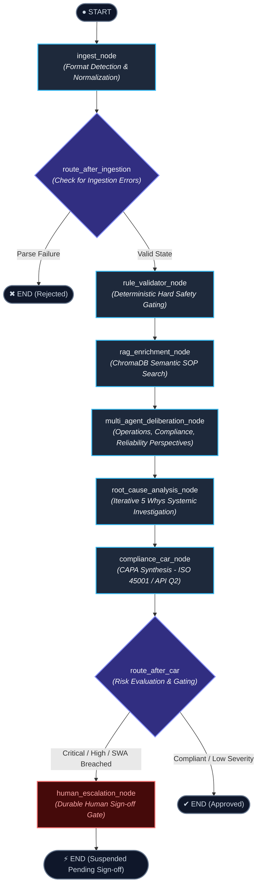

# System Architecture & Design Specification

## Overview

The **Safety Graph Orchestrator** is an enterprise-grade, stateful multi-agent safety workflow system built on **LangGraph**, **Ollama**, and **ChromaDB**. It enforces deterministic-first gating for critical oil & gas operations, incident investigations (SWA), and Job Safety Analyses (JSA/JHA).

```
+---------------------------------------------------------------------------------------+
|                              Operational Input Layer                                  |
|         [ Daily Drilling Report ]     [ Stop Work Authority ]     [ Job Safety JSA ]  |
+---------------------------------------------------------------------------------------+
                                           |
                                           v
+---------------------------------------------------------------------------------------+
|                                      ingest_node                                      |
|                 Format Detection -> Normalization -> UnifiedSafetyData                 |
+---------------------------------------------------------------------------------------+
                                           |
                                           v
+---------------------------------------------------------------------------------------+
|                                  rule_validator_node                                  |
|                 Deterministic Rule Engine (OSHA 1910 / API RP 54 / API 16D)           |
|                 Zero-Hallucination Gating (H2S >= 10 ppm, BOP Seals, LOTO)            |
+---------------------------------------------------------------------------------------+
                                           |
                                           v
+---------------------------------------------------------------------------------------+
|                                  rag_enrichment_node                                  |
|                 ChromaDB Vector Retrieval + Hybrid Keyword Boosting                   |
|                 Extracts Company SOPs, HAZWOPER & Regulatory Mandates                 |
+---------------------------------------------------------------------------------------+
                                           |
                                           v
+---------------------------------------------------------------------------------------+
|                             multi_agent_deliberation_node                             |
|          +--------------------+  +----------------------+  +---------------------+    |
|          | Operations Agent   |  | OSHA Compliance Agent|  | Forensic Reliability|    |
|          | (Schedule/Drill)   |  | (CFR Regulations)    |  | (Barrier Ruptures)  |    |
|          +--------------------+  +----------------------+  +---------------------+    |
+---------------------------------------------------------------------------------------+
                                           |
                                           v
+---------------------------------------------------------------------------------------+
|                              root_cause_analysis_node                                 |
|                 Safety Arbiter & Iterative 5 Whys Root Cause Synthesis                |
|                 Blame-Free Human Factors & Systemic Organizational RCA                |
+---------------------------------------------------------------------------------------+
                                           |
                                           v
+---------------------------------------------------------------------------------------+
|                                  compliance_car_node                                  |
|                 Corrective Action Plan (ISO 45001 / API Q2 CAPA Synthesis)            |
+---------------------------------------------------------------------------------------+
                                           |
                     +---------------------+---------------------+
                     | Severity >= CRITICAL or SWA Violation?    |
                     +-------------------------------------------+
                                   /               \
                             YES  /                 \  NO (Compliant / Low)
                                 v                   v
+-----------------------------------------+   +-----------------------------------------+
|          human_escalation_node          |   |                  [END]                  |
|    Durable SQLite State Checkpoint      |   |            Audit Auto-Approved          |
|    Blocks Restart Pending Sign-off      |   +-----------------------------------------+
+-----------------------------------------+
```

## LangGraph State Machine Specification

The pipeline is compiled using LangGraph's `StateGraph` with a durable `SqliteSaver` checkpointer:



## Core Architectural Components

### 1. Unified Operational Ingestion (`parsers/`)
- Ingests structured JSON, freeform narrative field notes, and industry-standard WITSML 1.4 XML logs.
- Detects document classification (DDR, SWA, JSA) via heuristic scoring and schema introspection.
- Normalizes disparate fields into a strongly-typed `UnifiedSafetyData` domain model.

### 2. Deterministic Rule Engine (`rules/`)
- Evaluates operational telemetry and incident descriptions against OSHA regulations (29 CFR 1910, 1926) and American Petroleum Institute standards (API RP 54, API Spec 16D).
- Implements deterministic, zero-hallucination gating:
  - H2S toxic gas limit: $\ge 10\text{ ppm}$
  - High pressure barrier degradation: $\ge 3,000\text{ PSI}$ with active leak
  - Stop Work Authority premature restart without supervisory sign-off
  - Fall protection deficiency: $\ge 6\text{ ft}$ without verified 100% dual tie-off
  - Hazardous energy zero-state verification (LOTO)

### 3. Vector Retrieval & Hybrid Search (`retrieval/`)
- Persistent ChromaDB collection indexed with seed oilfield safety regulations, company operating procedures, and HAZWOPER protocols.
- Incorporates hybrid search combining dense semantic embeddings with BM25 keyword boosting for equipment tags and API standard references.
- Dynamic document ingestion pipeline (`SOPDocumentIngestionPipeline`) supporting Markdown and plain text file ingestion with section-aware chunking.

### 4. Multi-Agent Deliberation Committee (`rca/deliberation.py`)
- Simulates a multi-disciplinary rig review panel comprising:
  - **Drilling Operations Specialist**: Evaluates operational pressures, tour handover cadence, and tripping dynamics.
  - **Regulatory Compliance Officer**: Evaluates OSHA / BSEE / API citation risk and mandatory reporting triggers.
  - **Forensic Reliability Engineer**: Diagnoses mechanical fatigue, pressure cycling, and barrier degradation.

### 5. 5 Whys Root Cause Arbiter (`rca/five_whys.py`)
- Employs local Ollama models (`llama3.2`) with a deterministic heuristic fallback to traverse the causal chain through 5 distinct levels.
- Enforces blame-free, systemic categorization:
  - Procedural Adherence & SOP Gap
  - Management Systems & Resource Allocation
  - Equipment Integrity & Mechanical Failure
  - Human Factors (Fatigue & Situational Awareness)
  - Communication & Shift Handover Gap

### 6. Corrective Action Synthesis (`compliance/car_generator.py`)
- Formulates structured Corrective Action Reports (CARs) adhering to ISO 45001 and API Q2 management standards.
- Categorizes actions into:
  - **Immediate Containment** (1 day turnaround)
  - **Corrective Engineering Remediation** (3–7 days turnaround)
  - **Preventive Systems Verification** (30 days turnaround)

### 7. Durable State Checkpointing & HITL Sign-off (`core/checkpoint.py`)
- Integrates `SqliteSaver` to preserve graph state between pauses.
- Halts execution when critical thresholds are breached, requiring authenticated review and sign-off before operational restart.
